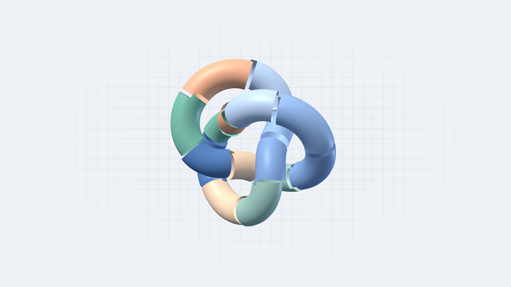

<h1 align="center">MeshQuilt</h1>
<h3 align="center">
  在浏览器里对大模型做快速 Draco 编解码。<br />
  体积更小。同一套量化网格。
</h3>

<p align="center">
  <a href="README.md">English</a>
  ·
  <a href="README.zh-CN.md">简体中文</a>
</p>

<p align="center">
  <a href="https://www.npmjs.com/package/meshquilt"></a>
  <a href="https://github.com/Innovgame/meshquilt/releases"></a>
  <a href="https://github.com/Innovgame/meshquilt/actions/workflows/ci.yml"></a>
  <a href="LICENSE"></a>
</p>

<a href="https://innovgame.github.io/meshquilt/"></a>

```bash
npm install meshquilt
```

同一版本也会发布到 GitHub Packages，包名是 `@innovgame/meshquilt`。

## 目录

1. [为什么用 MeshQuilt](#为什么用-meshquilt)
2. [入口](#入口)
3. [官网](#官网)
4. [文档](#文档)
5. [许可](#许可)
6. [参与贡献](#参与贡献)

## 为什么用 MeshQuilt

- **浏览器里的快速 Draco。** 把大模型拆成块，在主线程之外编码和解码。Worker 池并行处理各块，也可以用一个 Worker 跑完整条流水线。
- **体积小得多。** 位置、法线和 UV 先量化，再用 Draco 打进 MQLT，不必传输原始顶点缓冲。
- **所有分块共用一套网格。** 每个块使用同一量化体积，压缩后边界顶点仍落在同一网格上。
- **面向数组。** 输入和输出都是类型化数组。根入口没有运行时依赖。Draco 二进制由应用提供。

## 入口

| 导入入口           | 职责                                         |
| ------------------ | -------------------------------------------- |
| `meshquilt`        | 几何、分块、共享量化、合并，以及 MQLT 容器。 |
| `meshquilt/draco`  | 可注入的 Draco 适配器和浏览器 Worker 池。    |
| `meshquilt/worker` | 经典 Worker 文件，由应用自行部署。           |

没有发布 Three.js 适配器。材质、变换和模型加载属于应用。测试过的接入代码在 [`examples/three`](examples/three/README.md)。

### 编码与解码

```ts
import { encodeGeometry, decodeGeometry } from "meshquilt";
import { createDracoChunkEncoder, decodeDracoChunk } from "meshquilt/draco";

const geometry = {
    position: new Float32Array([0, 0, 0, 1, 0, 0, 0, 1, 0]),
    index: new Uint16Array([0, 1, 2])
};

// 先自行加载并初始化 Draco 模块。
const bytes = await encodeGeometry(geometry, {
    maxTriangles: 100_000,
    encodeChunk: createDracoChunkEncoder(encoderModule)
});
const decoded = await decodeGeometry(bytes, (payload) => decodeDracoChunk(decoderModule, payload));
```

支持 Uint16、Uint32 和无索引三角汤。见[快速上手](docs/zh/quick-start.md)。

### 合并分块

```ts
import { mergeGeometry } from "meshquilt";

const geometry = mergeGeometry(decoded.chunks);
```

合并是可选步骤。它保留接缝顶点，不焊接，也不再次量化。见[几何 API](docs/zh/geometry.md#合并几何)。

### Worker

```ts
import { createDracoWorkerPool } from "meshquilt/draco";

const pool = await createDracoWorkerPool({
    workerUrl,
    encoderScriptUrl: "/draco/draco_encoder.js",
    size: 2
});
```

把 `meshquilt/worker` 作为经典 Worker 提供。池大小保持在 2–4。见 [Worker](docs/zh/workers.md)。

## 官网

[项目官网](https://innovgame.github.io/meshquilt/)可以查看真实分块，导入 STL、OBJ、GLB 和 MQLT，并搜索中英文文档。

```bash
pnpm install
pnpm site
```

Pages 部署见 [apps/site/README.md](apps/site/README.md)。

## 文档

- [快速上手](docs/zh/quick-start.md)
- [几何 API](docs/zh/geometry.md)
- [Draco](docs/zh/draco.md)
- [Worker](docs/zh/workers.md)
- [Three.js 示例](docs/zh/three.md)
- [量化与接缝](docs/zh/quantization.md)
- [MQLT 容器](docs/zh/container-format.md)
- [运行时与内存](docs/zh/runtime-and-memory.md)
- [迁移](docs/zh/migration.md)
- [性能](docs/zh/performance.md)
- [更新日志](docs/zh/changelog.md)

## 许可

- MeshQuilt 使用 [MIT](LICENSE)。
- Draco 二进制由应用自行提供，许可证仍是 Apache-2.0。

## 参与贡献

欢迎提 Issue 和 Pull Request。开始前请阅读 [CONTRIBUTING.md](CONTRIBUTING.md)。漏洞请按 [SECURITY.md](SECURITY.md) 报告。

需要 Node.js 22.12+、24+ 或 26+，以及 pnpm 10.33.0。

```bash
pnpm install
pnpm check
pnpm test
pnpm test:packages
pnpm test:release
```

---

MeshQuilt © 2026 MeshQuilt contributors
